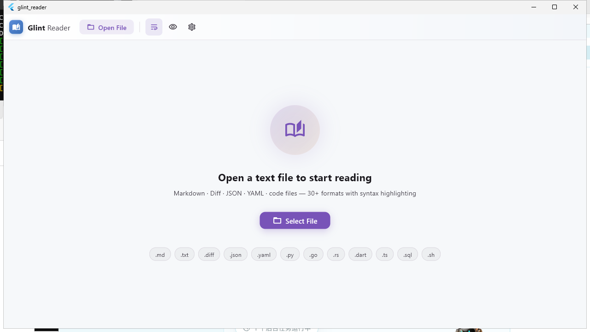
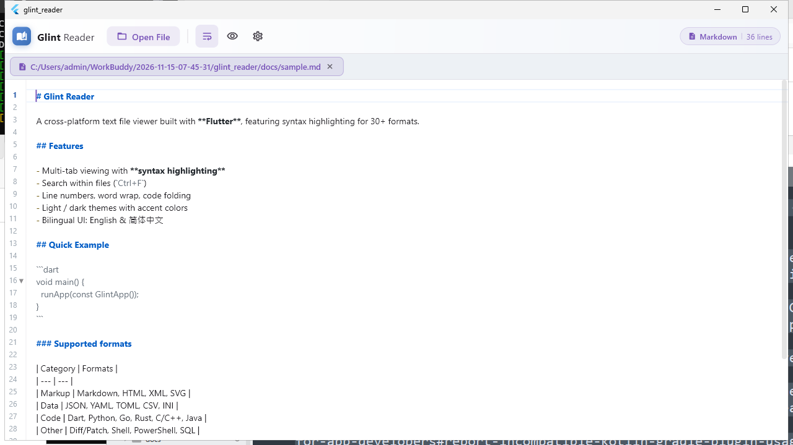
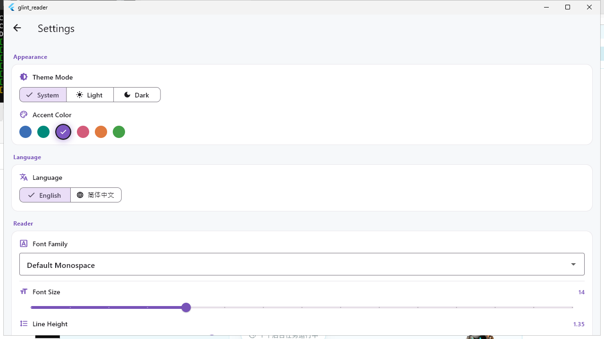

# Glint Reader

[](LICENSE)
[](https://flutter.dev)
[](https://github.com/liudonghua123/glint_reader/actions/workflows/gh-pages.yml)
[](https://github.com/liudonghua123/glint_reader/actions/workflows/release.yml)

A cross-platform text file viewer with syntax highlighting, built with Flutter.

Supports 60+ file formats including **Markdown, Diff/Patch, JSON, YAML, code files** and more.

[简体中文](README_zh.md)

## Screenshots

| Home | Viewer | Settings |
| --- | --- | --- |
|  |  |  |

## Features

- **Syntax highlighting** for 60+ formats: Markdown, Diff, JSON, YAML, XML, HTML, CSS, JS/TS, Python, Go, Rust, C/C++, Java, Kotlin, Swift, Dart, Scala, Haskell, Elixir, Clojure, Julia, Shell, PowerShell, SQL, GraphQL, Protobuf, LaTeX and more (powered by [re_highlight](https://pub.dev/packages/re_highlight))
- **Markdown & HTML preview** — Markdown rendered inline; HTML rendered in a real WebView (WebView2 on Windows, WKWebView on macOS, Android WebView) with dark-mode styling injected; source toggle for both
- **Recent files** — home screen shows recently opened files, click to reopen
- **Status bar** — file size, lines, characters, encoding; format-specific details (JSON validity, CSV rows/cols, diff +/- counts, headings/links/images for Markdown) expandable on click
- **In-app updates** — auto-check on startup (silent) + manual check; resumable downloads with a partial-file indicator; Android installs the downloaded APK directly via the system installer
- **Multi-tab** viewing — open several files at once
- **Search within file** (Ctrl+F) with match navigation
- **Line numbers** and code folding indicator
- **Word wrap** toggle
- **Read-only by default** with optional editing mode
- **Light / Dark themes** following the system (GitHub light / GitHub dark), with 6 selectable accent colors
- **Font family & size** settings (Consolas, Cascadia Code, JetBrains Mono, ...)
- **i18n** — English & 简体中文
- **Right-click context menu** (copy / select all)
- Cross-platform: **Windows / macOS / Linux / Android / iOS / Web**

## Getting Started

```bash
flutter pub get
flutter run -d windows   # or macos / linux / chrome / android / ios
```

### Build release

```bash
flutter build windows --release
flutter build apk --release
flutter build web --release --base-href /glint_reader/
```

## Usage

1. Click **Open File** on the home screen
2. Pick any supported text file — the language is auto-detected from the extension
3. Switch tabs to browse between open files
4. Toggle wrap / edit mode from the toolbar; press Ctrl+F to search
5. Open **Settings** to customize theme, accent color, language, font, line numbers and word wrap

## Download

Grab pre-built binaries from the [Releases](https://github.com/liudonghua123/glint_reader/releases) page:

| Platform | Artifact |
| --- | --- |
| Windows | `glint_reader-windows-x64.zip` |
| macOS | `glint_reader-macos.zip` |
| Linux | `glint_reader-linux-x64.tar.gz` |
| Android | `glint_reader-android.apk` |
| Web | deployed to [GitHub Pages](https://liudonghua123.github.io/glint_reader/) |

## Project Structure

```
lib/
├── main.dart               # App entry & theming
├── models.dart             # FileKind registry (extensions → languages)
├── settings.dart           # App settings model (persisted)
├── settings_page.dart      # Settings UI
├── i18n.dart               # Language service & translations
├── highlight_service.dart  # re_highlight theme wiring
├── home_page.dart          # Toolbar, tabs, file picking
└── viewer_page.dart        # Code editor view, find panel, context menu
```

## Contributing

Contributions are welcome! Feel free to open an issue or submit a pull request.

1. Fork the repository
2. Create your feature branch (`git checkout -b feature/amazing-feature`)
3. Commit your changes (`git commit -m 'Add some amazing feature'`)
4. Push to the branch (`git push origin feature/amazing-feature`)
5. Open a Pull Request

## License

This project is licensed under the MIT License — see the [LICENSE](LICENSE) file for details.
