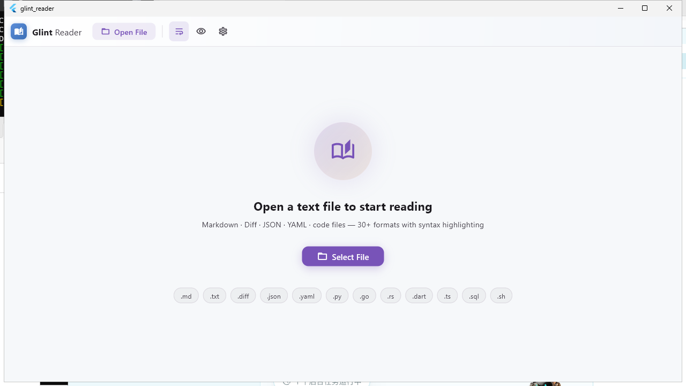
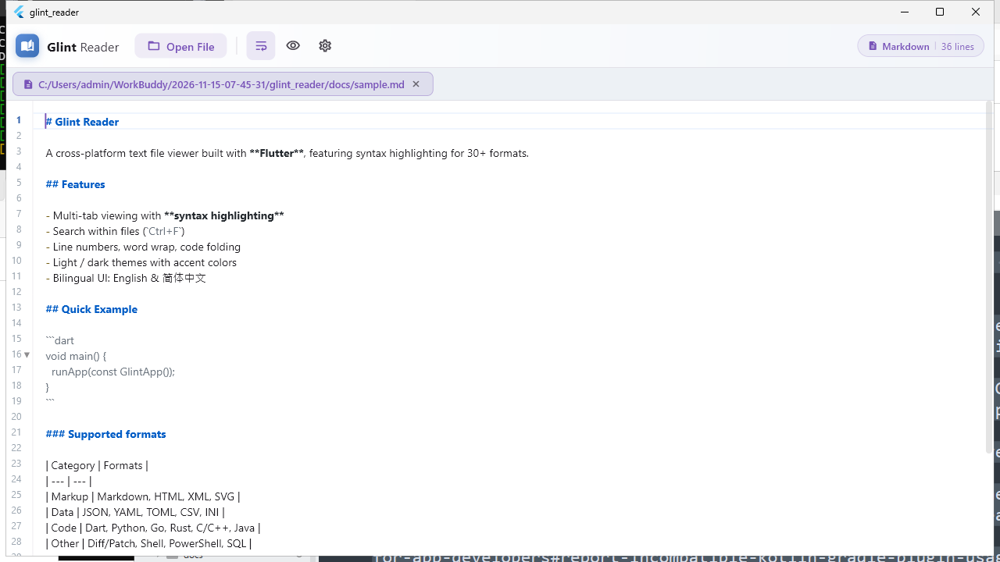
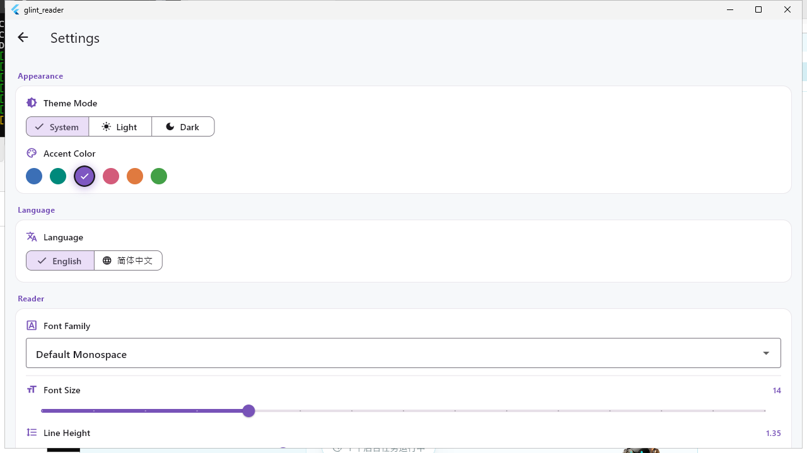

# Glint Reader

<div align="center">
  
</div>

[](LICENSE)
[](https://flutter.dev)
[](https://github.com/liudonghua123/glint_reader/actions/workflows/gh-pages.yml)
[](https://github.com/liudonghua123/glint_reader/actions/workflows/release.yml)

基于 Flutter 的跨平台文本文件查看器，支持语法高亮。

支持 60+ 种文件格式，包括 **Markdown、Diff/Patch、JSON、YAML、各类代码文件**等。

[English](README.md)

## 截图

| 主页 | 查看器 | 设置 |
| --- | --- | --- |
|  |  |  |

## 功能特性

- **语法高亮**支持 60+ 种格式：Markdown、Diff、JSON、YAML、XML、HTML、CSS、JS/TS、Python、Go、Rust、C/C++、Java、Kotlin、Swift、Dart、Scala、Haskell、Elixir、Clojure、Julia、Shell、PowerShell、SQL、GraphQL、Protobuf、LaTeX 等（基于 [re_highlight](https://pub.dev/packages/re_highlight)）
- **Markdown & HTML 预览**，Markdown 内联渲染；HTML 使用真实 WebView 渲染（Windows WebView2 / macOS WKWebView / Android WebView），自动注入深色配色，均可切换源码
- **最近打开**，主页显示最近打开的文件，点击即可重新打开
- **底部状态栏**，文件大小、行数、字符数、编码；特定格式显示专属详情（JSON 有效性、CSV 行列数、Diff 增删行数、Markdown 标题/链接/图片数），点击可展开
- **应用内更新**，启动后自动静默检测 + 手动检查；下载支持断点续传（自动识别已下载部分）；Android 下载完成后直接调起系统安装器安装
- **多标签页**查看，同时打开多个文件
- **文件内搜索**（Ctrl+F），支持匹配跳转
- **行号显示**与代码折叠指示
- **自动换行**开关
- **默认只读**，可切换编辑模式
- **浅色 / 深色主题**跟随系统（GitHub light / GitHub dark），6 种主题色可选
- **字体与字号**设置（Consolas、Cascadia Code、JetBrains Mono 等）
- **国际化** — 简体中文 & English
- **右键菜单**（复制 / 全选）
- 跨平台：**Windows / macOS / Linux / Android / iOS / Web**

## 快速开始

```bash
flutter pub get
flutter run -d windows   # 或 macos / linux / chrome / android / ios
```

### 构建发布版

```bash
flutter build windows --release
flutter build apk --release
flutter build web --release --base-href /glint_reader/
```

## 使用说明

1. 点击主界面的 **打开文件**
2. 选择任意受支持的文本文件 —— 语言根据扩展名自动识别
3. 通过标签页切换已打开的文件
4. 工具栏可切换换行 / 编辑模式；按 Ctrl+F 搜索
5. 打开 **设置** 可自定义主题、主题色、语言、字体、行号与自动换行

## 下载

从 [Releases](https://github.com/liudonghua123/glint_reader/releases) 页面获取预编译产物：

| 平台 | 产物 |
| --- | --- |
| Windows | `glint_reader-windows-x64.zip` |
| macOS | `glint_reader-macos.zip` |
| Linux | `glint_reader-linux-x64.tar.gz` |
| Android | `glint_reader-android.apk` |
| Web | 部署于 [GitHub Pages](https://liudonghua123.github.io/glint_reader/) |

## 项目结构

```
lib/
├── main.dart               # 应用入口与主题
├── models.dart             # FileKind 注册表（扩展名 → 语言）
├── settings.dart           # 应用设置模型（持久化）
├── settings_page.dart      # 设置页面
├── i18n.dart               # 语言服务与翻译表
├── highlight_service.dart  # re_highlight 主题接线
├── home_page.dart          # 工具栏、标签页、文件打开
└── viewer_page.dart        # 代码视图、查找面板、右键菜单
```

## 参与贡献

欢迎贡献！欢迎提交 issue 或 pull request。

1. Fork 本仓库
2. 创建功能分支（`git checkout -b feature/amazing-feature`）
3. 提交更改（`git commit -m 'Add some amazing feature'`）
4. 推送分支（`git push origin feature/amazing-feature`）
5. 发起 Pull Request

## 许可证

本项目基于 MIT 许可证开源 —— 详见 [LICENSE](LICENSE)。
